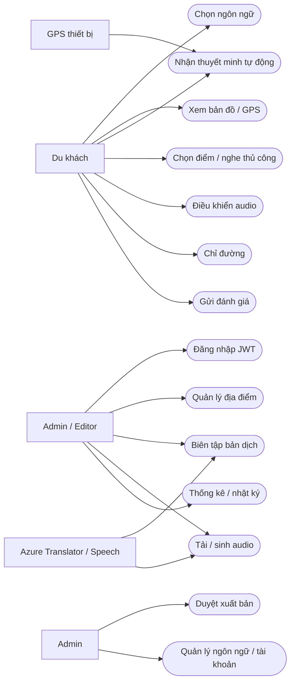
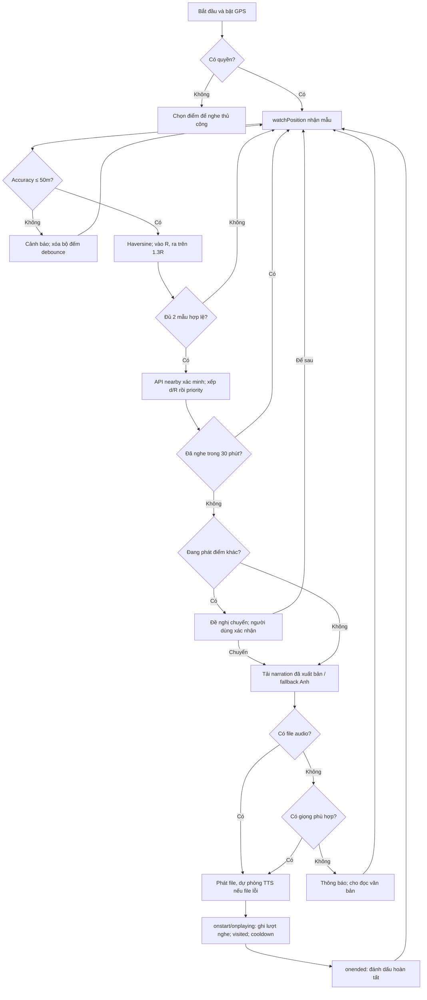
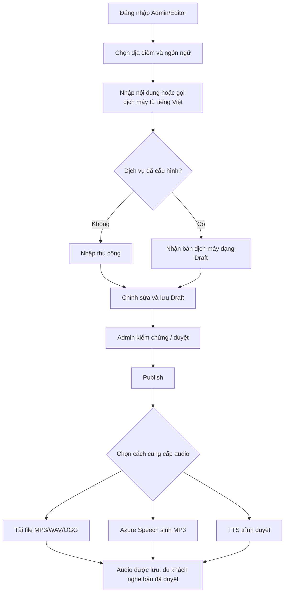
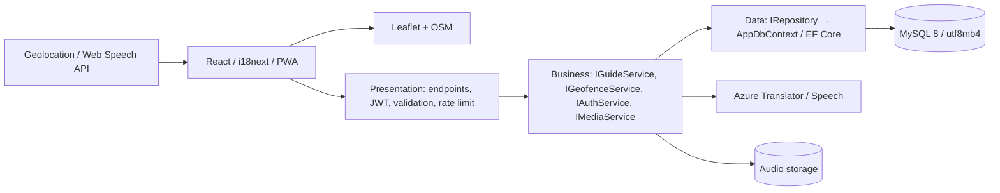
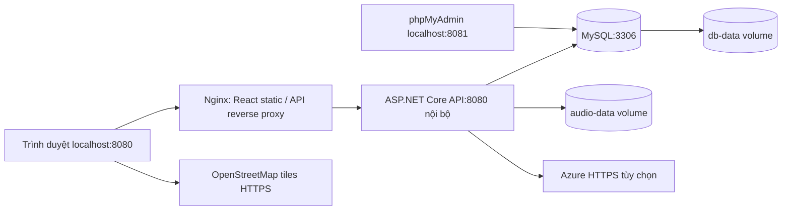
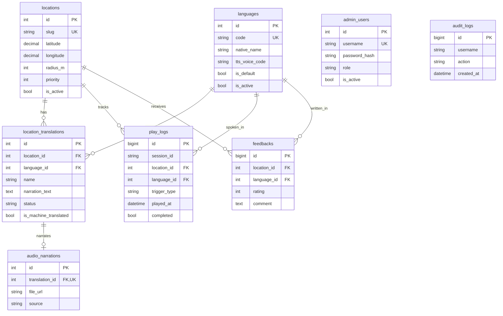

# Kiến trúc và sơ đồ

Mã nguồn bám kiến trúc 3 lớp. Presentation ở `AudioGuide.Api` nhận request, xác thực, kiểm tra dữ liệu và gọi interface dịch vụ. Business ở `AudioGuide.Business` xử lý geofence, narration/fallback, auth, xuất bản, thống kê và tích hợp Azure. Data ở `AudioGuide.Data` quản lý entities, DbContext, Repository và migration MySQL. DI nối interface với implementation; truy vấn EF tham số hóa.

## Use case



## Activity — tự động theo GPS



## Activity — biên tập đa ngôn ngữ



## Component



## Deployment localhost



Nginx chỉ mở loopback HTTP cho localhost; triển khai điện thoại qua LAN/Internet cần lớp HTTPS và cấu hình mạng riêng. API không publish port từ Docker. MySQL/phpMyAdmin chỉ mở loopback. Container API chạy user `app` không phải root. Build có tùy chọn BuildKit CA secret cho proxy doanh nghiệp; CA chỉ dùng trong lệnh build, không được đưa vào runtime image.

## ERD



Cặp `(location_id, language_id)` là unique. Index cho địa điểm hoạt động/thứ tự và lượt nghe theo điểm/ngày. Không xóa location/language đã có nội dung, lượt nghe hoặc phản hồi: API trả 409 và hướng dẫn tắt trạng thái. Xóa translation sẽ xóa metadata audio liên quan; file vật lý giữ để không phá cache. Bảng `__EFMigrationsHistory` do EF quản lý.

## Sequence — nghe một điểm

```mermaid
sequenceDiagram
 participant U as Du khách
 participant UI as React
 participant API as API
 participant B as GuideService
 participant D as MySQL
 U->>UI: Chọn điểm hoặc GPS kích hoạt
 UI->>API: GET /api/locations/id/narration?lang=ko
 API->>B: Narration(id, ko)
 B->>D: Published + language active + location active
 alt Thiếu bản ko
 B->>D: Tìm bản en đã xuất bản
 end
 D-->>B: Nội dung + audio
 B-->>UI: DTO và cờ fallback
 UI->>U: Hiện thông tin; phát file/TTS
 UI->>API: POST /api/playlogs (khi thực sự bắt đầu)
 API->>D: Ghi session ẩn danh, không có tọa độ
 UI->>API: PUT /api/playlogs/id/complete (khi kết thúc)
```
